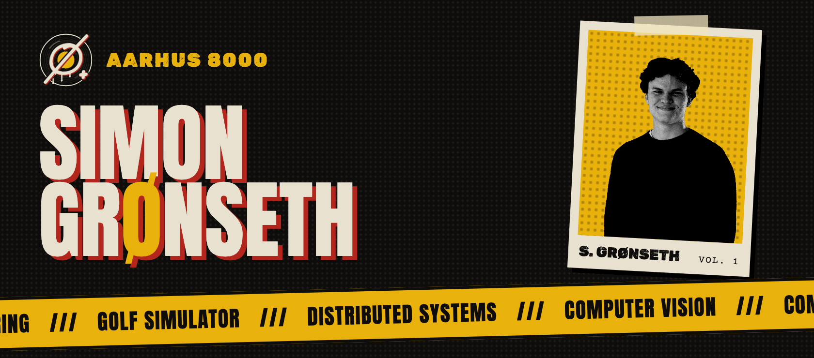
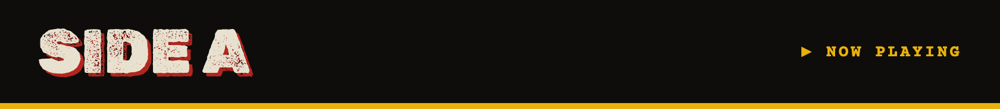
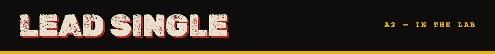
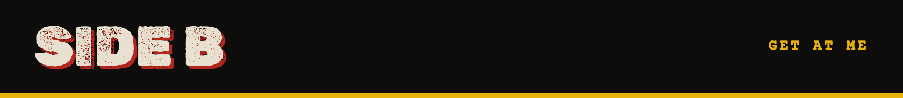
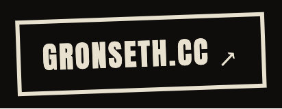
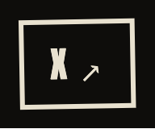

  

<code>COMPUTER ENGINEERING @ AARHUS UNIVERSITY</code> · <code>AARHUS 8000, DK</code> · <code>VOL. 1 — 2026</code>

> Hey, I'm **Simon**. I'm a computer engineering student in Aarhus, building things that probably need fewer cameras than I give them.
> Right now: a golf simulator, which in practice means distributed systems and computer vision.

 

| | Track | |
|:--|:--|--:|
| **A1** | **Computer engineering** At Aarhus University. | `STUDYING` |
| **A2** | **Golf simulator** Tracking a ball you can't see with cameras that won't agree. | `BUILDING` |
| **A3** | **Distributed systems & computer vision** What makes the simulator tick. | `LEARNING` |
| **A4** | **Procrastinating productively** Bonus track. | `DAILY` |

 

### ⛳ Golf simulator
Multiple cameras, one tiny fast ball, and a lot of disagreeing about where it went.

- **Computer vision**: detecting and tracking the ball across frames and cameras
- **Distributed systems**: keeping capture, processing and simulation in sync across machines
- **Status**: in the lab 🔊 (work in progress, repo coming when it's less embarrassing)

<!-- When the repo is public, link it here:

-->

 

**✉ [simon@gronseth.cc](mailto:simon@gronseth.cc)**

  
  
  
  
  

---

**LINER NOTES** · Produced, written & arranged by Simon Grønseth · Recorded in Aarhus, Denmark · Mixed at 3 a.m. · Made with too much coffee.
